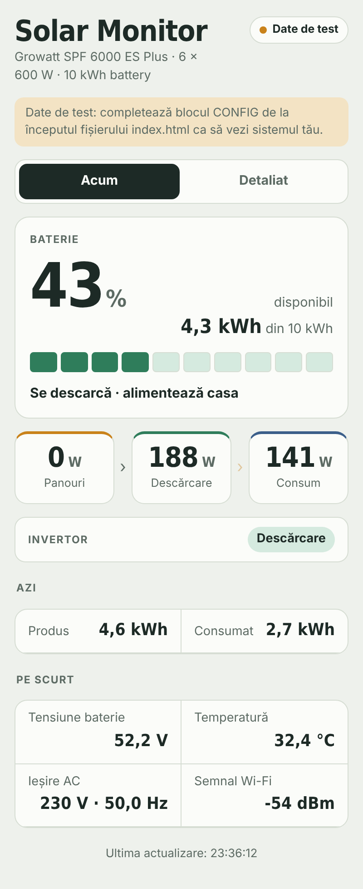
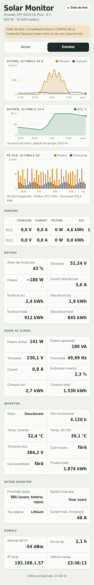

# Growatt ShineWiFi-X2 → ESPHome

Monitorizare locală, fără cloud-ul Growatt, pentru invertoarele off-grid **Growatt SPF**, prin rescrierea stick-ului **ShineWiFi-X2** (ESP32-C3) cu ESPHome.

> **English:** [README.md](README.md) · [Step-by-step guide](docs/GUIDE.en.md)

## Ce obții

- Stick-ul citește invertorul la fiecare 10 secunde, prin Modbus: panourile PV, bateria (SOC, tensiune, putere, energie), ieșirea AC, temperaturile, starea, codurile de eroare și avertizare, plus setările (prioritatea ieșirii, sursa de încărcare, tipul bateriei, curentul maxim de încărcare).
- Două moduri de a primi datele:
  - **HiveMQ Cloud + o pagină web** pe GitHub Pages: le vezi de oriunde, fără server propriu. Merge și pe 4G fără IP public.
  - **Home Assistant**, prin brokerul Mosquitto, cu descoperire automată MQTT.
- **Istoric ținut de stick:** ultimele 24 de ore, câte un punct pe minut, plus producția și consumul pe zi pentru ultimele 30 de zile.
- **Wi-Fi setat pe loc:** la prima pornire stick-ul face hotspotul **DongleGrowatt**, din care alegi rețeaua de pe telefon.
- **Actualizări prin Wi-Fi**, din pagina web a stick-ului, după prima scriere.
- **O pagină web** adaptată pentru telefon, cu două file, Acum și Detaliat, în română sau engleză. O poți pune pe ecranul principal al iPhone-ului, ca o aplicație.

## Hardware pe care a fost făcut și testat

| | |
| --- | --- |
| Stick | Growatt ShineWiFi-X2, placa **B700.0198800** |
| Modul | Ai-Thinker ESP-C3-13U (ESP32-C3, flash 4 MB încorporat) |
| Partea USB | CH340, legătura cu invertorul pe GPIO0 (TX) / GPIO1 (RX), 115200 8N1 |
| Invertor | Growatt **SPF 6000 ES Plus** (alte modele SPF cu același protocol off-grid ar trebui să meargă) |

Stick-urile mai vechi ShineWiFi-X folosesc ESP8266 și alți pini; proiectul acesta e pentru X2.

## De unde începi

**→ [Ghid pas cu pas](docs/GHID.ro.md)**: de la backup-ul firmware-ului Growatt până la pagina web pe telefon.

Pe scurt:

1. Deschizi stick-ul, legi un adaptor USB-TTL pe 3,3 V la header (`3.3V · G · TX0 · RX0 · RST · IO9 · G`) și unești IO9 cu G.
2. Verifici că Secure Boot și Flash Encryption sunt dezactivate, apoi **faci backup la firmware-ul original**.
3. Creezi un cluster HiveMQ Cloud (sau folosești Mosquitto din Home Assistant).
4. Copiezi `firmware/secrets.example.yaml` în `secrets.yaml`, îl completezi și compilezi `firmware/growatt-dongle.yaml` cu ESPHome.
5. Scrii `firmware.factory.bin`, te conectezi la hotspotul **DongleGrowatt** și alegi rețeaua Wi-Fi.
6. Bagi stick-ul în invertor.
7. Completezi blocul `CONFIG` din `web/index.html` și îl publici cu GitHub Pages.

## Conținutul repository-ului

| Cale | Conținut |
| --- | --- |
| `firmware/growatt-dongle.yaml` | firmware-ul principal (HiveMQ Cloud sau orice broker cu TLS) |
| `firmware/growatt-dongle-ha.yaml` | varianta pentru Home Assistant (Mosquitto local, descoperire MQTT) |
| `firmware/secrets.example.yaml` | model pentru parole și broker |
| `firmware/diag-pin-scan.yaml` | diagnostic: arată nivelul pinilor GPIO, ca să găsești pinii UART |
| `firmware/diag-uart-debug.yaml` | diagnostic: afișează fiecare octet trimis și primit de la invertor |
| `web/index.html` | pagina web (completezi blocul `CONFIG`) |
| `docs/GHID.ro.md` · `docs/GUIDE.en.md` | ghidul complet, în română și engleză |
| `docs/registers.md` | registrele Modbus și topicurile MQTT |

## Siguranță

Modifici propriul hardware, pe propriul risc. Păstrează mereu backup-ul firmware-ului original: cu el readuci stick-ul la starea din fabrică. Nu lega niciodată 5 V la header și nu rula comenzi `espefuse burn`. Proiectul doar **citește** date din invertor și nu scrie nicio setare.

Proiectul nu e afiliat cu Growatt. Growatt, ShineWiFi și SPF sunt mărci ale proprietarilor lor.

## Autor

**Barbu Dan-Cristian**. Publicat sub [licența MIT](LICENSE).
