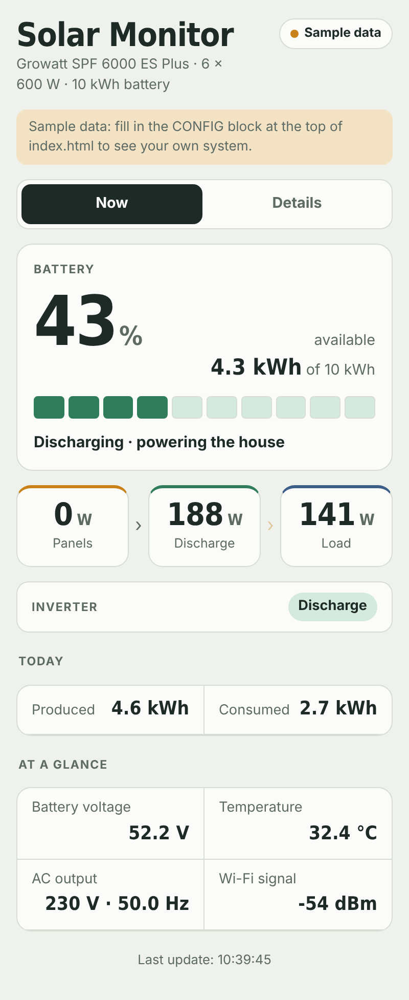
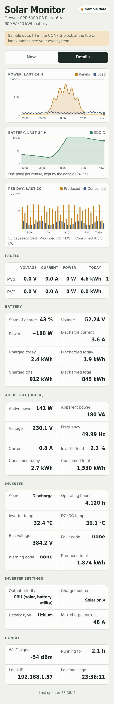

# Step-by-step guide (English)

This guide turns a Growatt **ShineWiFi-X2** stick into an ESPHome device that reads a Growatt **SPF** off-grid inverter locally and sends the data either to the cloud (HiveMQ + a web page you can open anywhere) or to your own **Home Assistant**. Every step was done on real hardware; the commands are for Windows 11.

> Română: [GHID.ro.md](GHID.ro.md)

**Contents**

1. [Before you start](#1-before-you-start)
2. [Install the tools](#2-install-the-tools)
3. [Open the stick and identify the board](#3-open-the-stick-and-identify-the-board)
4. [Wire the USB-TTL adapter](#4-wire-the-usb-ttl-adapter)
5. [Enter download mode and identify the chip](#5-enter-download-mode-and-identify-the-chip)
6. [Check that the chip is not locked](#6-check-that-the-chip-is-not-locked)
7. [Back up the stock Growatt firmware](#7-back-up-the-stock-growatt-firmware)
8. [Know your UART pins](#8-know-your-uart-pins) \* *optional*
9. [Choose where the data goes](#9-choose-where-the-data-goes)
10. [Option A: HiveMQ Cloud](#10-option-a-hivemq-cloud)
11. [Option B: Home Assistant (Mosquitto)](#11-option-b-home-assistant-mosquitto)
12. [Configure the firmware](#12-configure-the-firmware)
13. [Compile](#13-compile)
14. [First flash](#14-first-flash)
15. [First boot: Wi-Fi through the DongleGrowatt hotspot](#15-first-boot-wi-fi-through-the-donglegrowatt-hotspot)
16. [Put it in the inverter and check the values](#16-put-it-in-the-inverter-and-check-the-values)
17. [Updates over Wi-Fi (OTA)](#17-updates-over-wi-fi-ota)
18. [Web page on GitHub Pages](#18-web-page-on-github-pages)
19. [Add the page to an iPhone Home Screen](#19-add-the-page-to-an-iphone-home-screen)
20. [History](#20-history)
21. [Troubleshooting](#21-troubleshooting)
22. [Going back to the Growatt firmware](#22-going-back-to-the-growatt-firmware)

---

## 1. Before you start

**You need**

- A ShineWiFi-X2 stick (tested: board **B700.0198800**, label "ShineWiFi-X2 (C)")
- A USB-TTL adapter that can run at **3.3 V** (CP2102, CH340 or FT232)
- 5–6 female-female dupont wires, or a few male header pins
- A multimeter (only needed if your board differs from the one described here)
- A Windows 11 PC (Linux and macOS work too; use the same commands with `/dev/ttyUSB0` or `/dev/cu.*` instead of `COMx`)
- For option A: a free HiveMQ Cloud account and a GitHub account. For option B: Home Assistant.

**Read this first**

- Flashing replaces the Growatt firmware. With the backup from step 7 you can always go back.
- The ESP32-C3 is a 3.3 V chip. **Never connect 5 V** to the stick's header.
- Never power the stick from the adapter and from USB (PC or inverter) at the same time.
- Never run `espefuse burn-...` commands. eFuses are one-time and cannot be undone.
- You do this at your own risk. If step 6 shows Secure Boot or Flash Encryption enabled, stop.

## 2. Install the tools

Open **Terminal** (right-click Start → Terminal) and run:

```
winget install Python.Python.3.12
```

Close and reopen Terminal, then:

```
python -m pip install esptool esphome pyserial
python -m esptool version
```

Create a short working folder, for example `C:\esp`, and copy the `firmware` folder of this repository into it. ESP toolchains fail on long Windows paths, so keep it short.

## 3. Open the stick and identify the board

Remove the two screws and slide the board out. On the side with the metal-shielded module you should find:

| Part | What it is |
| --- | --- |
| Metal module, marked U6 | Ai-Thinker **ESP-C3-13U** (ESP32-C3) with a u.FL antenna |
| 7-hole header next to it | `3.3V · G · TX0 · RX0 · RST · IO9 · G` |
| U4, 16 pins, crystal XL1 next to it | **CH340** USB-to-serial chip |
| CN1 | the USB-A plug that goes into the inverter |

On some units the chips are covered with black paint. You don't need to read them: the steps below identify everything by behaviour.

**How it works inside:** the inverter talks to the stick over real USB. The CH340 turns that into a serial line on **GPIO0 (TX)** and **GPIO1 (RX)** of the ESP32-C3. The header (TX0/RX0 = GPIO21/GPIO20) is a separate UART, used only for programming. That is why you cannot flash through the USB plug.

## 4. Wire the USB-TTL adapter

Take the stick **out of the inverter and out of any USB port**. It will be powered from the adapter.

| Adapter | Stick header |
| --- | --- |
| GND | G |
| 3V3 (not 5V) | 3.3V |
| TXD | RX0 |
| RXD | TX0 |
| — | **IO9 bridged to G** (download mode) |

The bridge between IO9 and the G next to it must make good contact at the moment of power-on. Two header pins and a jumper wire hold better than tweezers.

Plug the adapter into the PC and note its port in **Device Manager → Ports (COM & LPT)**, for example `COM7` ("Silicon Labs CP210x USB to UART Bridge"). If the driver is missing, get it from silabs.com (CP210x) or wch-ic.com (CH340).

## 5. Enter download mode and identify the chip

With the IO9–G bridge in place, unplug and replug the adapter (this restarts the stick in download mode). Then:

```
python -m esptool --chip esp32c3 -p COM7 --before no-reset chip-id
python -m esptool --chip esp32c3 -p COM7 --before no-reset flash-id
```

Expected: `Chip type: ESP32-C3 (QFN32)`, `Embedded Flash 4MB`, `Detected flash size: 4MB`.

If you get "No serial data received": swap TXD/RXD, check the IO9 bridge, replug the adapter and try again.

Most cheap adapters have no RTS line wired to the stick, so the "Hard resetting via RTS pin" at the end of each command does nothing. **Unplug and replug the adapter before each new esptool command**, especially after commands that used `-b 230400`.

## 6. Check that the chip is not locked

```
python -m esptool --chip esp32c3 -p COM7 --before no-reset get-security-info
```

| Line | Must be |
| --- | --- |
| Secure Boot | Disabled |
| Flash Encryption | Disabled |
| SPI Boot Crypt Count (SPI_BOOT_CRYPT_CNT) | 0x0 |

If any of these is enabled, **stop here**: custom firmware will not run on that stick.

## 7. Back up the stock Growatt firmware

Read the whole flash twice and compare. Run the commands **one at a time, not all at once**: the adapter cannot reset the chip (its RTS pin is not wired), and after a read the chip stays at 230400 baud, so a second command run right after the first one fails.

**a) First backup.** Unplug the adapter from USB, plug it back in, then:

```
python -m esptool --chip esp32c3 -p COM7 --before no-reset -b 230400 read-flash 0 ALL stock_backup_1.bin
```

**b) Second backup.** Wait for the first read to finish, unplug the adapter from USB again, plug it back in, then:

```
python -m esptool --chip esp32c3 -p COM7 --before no-reset -b 230400 read-flash 0 ALL stock_backup_2.bin
```

**c) Move them into a separate folder and compare them** (the adapter is not needed for this):

```
mkdir Backup-ShineWiFi-X2
Move-Item stock_backup_1.bin, stock_backup_2.bin Backup-ShineWiFi-X2
Get-FileHash Backup-ShineWiFi-X2\*.bin
```

Each read takes about 3 minutes and gives a 4,194,304-byte file. The two SHA256 hashes must be identical. If not, repeat with `-b 115200`.

Keep the backup in two places and **never publish it**: it contains your Wi-Fi password and the Growatt cloud keys.

## 8. Know your UART pins

> **\* Optional step.** On board B700.0198800 the pins are already set in the firmware, so you can **skip this step and go straight to step 9**. Come back here only if your board is a different revision, or if after step 16 the values stay at NA (troubleshooting).

On board B700.0198800 the pins are **TX = GPIO0, RX = GPIO1, 115200 baud, 8N1, Modbus address 1**. They are already set in the firmware. If your board looks different, verify them:

**a) Watch the stock firmware talk (before flashing anything).** Remove the IO9 bridge and the adapter, plug the stick directly into a PC USB port. It appears as "USB-SERIAL CH340" (for example `COM6`). Then:

```
python -m serial.tools.miniterm COM6 115200 --encoding hexlify
```

You should see repeated Modbus requests such as `00 03 00 2B 00 01 F5 D3` and `00 03 00 D1 00 0F 54 26`. That proves the CH340 path works and the speed is 115200. Exit with **Ctrl+]**.

**b) Find the RX pin with the pin-scan firmware.** If the main firmware later gets no answers, flash `diag-pin-scan.yaml` (same steps as 13–14). It shows the level of 14 GPIOs on the stick's web page. Plug the stick into the PC, open miniterm on the CH340 port without `--encoding`, press **Ctrl+T then Ctrl+B** (break: holds the CH340 TX line low). The GPIO that turns OFF only during break is your RX pin. On B700.0198800 it is GPIO1.

**c) Confirm both directions with `diag-uart-debug.yaml`.** It logs every byte: `>>>` sent, `<<<` received. With the stick in the PC, the requests must appear in miniterm (TX works) and the keys you press in miniterm must appear as `<<<` lines on the stick's web log (RX works).

## 9. Choose where the data goes

| | A. HiveMQ Cloud + web page | B. Home Assistant |
| --- | --- | --- |
| Works from | anywhere (phone, any network) | your local network (or HA remote access) |
| Needs | free HiveMQ account, GitHub account | Home Assistant with the Mosquitto add-on |
| Firmware file | `growatt-dongle.yaml` | `growatt-dongle-ha.yaml` |
| Good for | remote sites without a server (cabins, farms) | homes that already run HA |

Both versions publish the same topics and the same history, so the web page works with either.

Option A suits remote sites: the stick sends data out to the cloud, nothing comes in, so it works even on 4G connections without a public IP.

## 10. Option A: HiveMQ Cloud

1. Create an account at console.hivemq.cloud and a **Serverless (Free)** cluster.
2. Note the **Cluster URL**, for example `abc123….s1.eu.hivemq.cloud`. Ports: **8883** (MQTT over TLS, for the stick) and **8884** with path `/mqtt` (WebSocket over TLS, for the web page).
3. Under **Access Management** create two credentials:

| Username | Permission | Used by |
| --- | --- | --- |
| `dongle` | Publish and Subscribe | the stick (secrets.yaml) |
| `viewer` | **Subscribe Only** | the web page (public) |

The `viewer` password will be visible in the page source, which is why it may only subscribe.

The firmware already contains the ISRG Root X1 certificate that HiveMQ Cloud uses. For another TLS broker, replace `certificate_authority` with that broker's root certificate.

## 11. Option B: Home Assistant (Mosquitto)

1. In Home Assistant: **Settings → Add-ons → Add-on Store → Mosquitto broker → Install → Start**.
2. **Settings → Devices & Services**: the **MQTT** integration is usually discovered automatically; click **Configure**. Otherwise add it with host `core-mosquitto`, port 1883.
3. Create a user for the stick: **Settings → People → Users → Add user**, for example `growatt-dongle`, with a password. Mosquitto accepts Home Assistant users.
4. Use `firmware/growatt-dongle-ha.yaml`. In `secrets.yaml` put the IP of your Home Assistant as `mqtt_broker` and that user as `mqtt_username` / `mqtt_password`.
5. After the stick connects, a device with all sensors appears under the MQTT integration (MQTT discovery). Long-term history and the Energy dashboard work as with any other HA sensor.

The web page from step 18 can also read from Mosquitto through its WebSocket listener, but only inside your network. For remote viewing, option A is simpler.

You can also skip MQTT entirely and use the ESPHome native API (`api:`). The stick then appears through the ESPHome integration. That is outside the scope of this guide, but the sensor part of the YAML stays the same.

## 12. Configure the firmware

In `C:\esp\firmware`:

1. Copy `secrets.example.yaml` to `secrets.yaml` and fill in your values. The hotspot password needs at least 8 characters.
2. Open `growatt-dongle.yaml` (or `-ha.yaml`). Everything you may want to change is in `substitutions` at the top:

| Setting | Default | Meaning |
| --- | --- | --- |
| `name` | `growatt-dongle` | device name; build folder and network host name |
| `friendly` | `Growatt Dongle` | title of the stick's local web page |
| `hotspot_ssid` | `DongleGrowatt` | Wi-Fi hotspot used for setup |
| `mqtt_prefix` | `growatt/dongle` | start of all MQTT topics; use a different one per stick |
| `timezone` | Eastern Europe | POSIX TZ string, used for history and daily totals |
| `uart_tx` / `uart_rx` | `GPIO0` / `GPIO1` | pins to the CH340 (step 8) |
| `baud` | `115200` | inverter link speed |
| `modbus_address` | `0x1` | inverter Modbus address |

## 13. Compile

```
cd C:\esp\firmware
python -m esphome compile growatt-dongle.yaml
```

The first compile downloads the ESP32-C3 toolchain and takes 10–20 minutes. The results (ESPHome 2026.10) are in `C:\esp\firmware\.esphome\build\growatt-dongle\build\`:

| File | Used for |
| --- | --- |
| `firmware.factory.bin` | the first flash, by cable |
| `firmware.ota.bin` | later updates over Wi-Fi |

## 14. First flash

Adapter wired as in step 4, IO9 bridged, adapter replugged. Then either:

- **Browser:** Chrome or Edge → web.esphome.io → **Connect** → choose the adapter's port → **Install** → pick `firmware.factory.bin`, or
- **Terminal:**

```
python -m esptool --chip esp32c3 -p COM7 --before no-reset -b 230400 write-flash 0x0 firmware.factory.bin
```

Then remove the IO9 bridge and disconnect the adapter.

## 15. First boot: Wi-Fi through the DongleGrowatt hotspot

The firmware contains no Wi-Fi network on purpose, so you can set it on site.

1. Power the stick from its own USB plug: a phone charger, a PC port, or the inverter. The adapter's 3.3 V output is often too weak for Wi-Fi.
2. On your phone, join the Wi-Fi network **DongleGrowatt** (password: `hotspot_password` from secrets.yaml).
3. The setup page opens by itself (or open `http://192.168.4.1`). Choose your 2.4 GHz network, type its password, save.
4. The stick joins your network. Find its IP in your router's client list (host name `growatt-dongle`) and open `http://<IP>` with the web user and password from secrets.yaml.

If the saved network disappears, the hotspot comes back after about a minute and you can choose another one.

## 16. Put it in the inverter and check the values

Plug the stick into the inverter's dongle port. Within seconds the sensors on the stick's web page fill in: battery SOC and voltage, load, PV, temperatures, status, settings.

If they stay at NA, flash `diag-uart-debug.yaml` and look at the log: `>>>` lines without any `<<<` mean nothing comes back from the inverter. See step 8 and step 21.

Compare a few values with the inverter display or another monitor. On an SPF 6000 ES Plus these matched: load, temperature, battery voltage, SOC, output voltage and battery power. **Battery power is positive while discharging and negative while charging.**

## 17. Updates over Wi-Fi (OTA)

After the first flash you never need the cable again, as long as you are on the same network as the stick:

1. Compile again (step 13).
2. Open the stick's web page → **OTA Update** → choose `firmware.ota.bin` (not the factory file) → **Update**.

Wi-Fi settings survive updates.

## 18. Web page on GitHub Pages

`web/index.html` is a single file that connects to your broker and shows two tabs: **Now** (battery, energy flow, today) and **Details** (24 h charts, 30-day chart, panels, battery, AC output, inverter, settings, dongle).

<p>


</p>

*The screenshots show the sample data the page displays until `CONFIG` is filled in.*

1. Open `web/index.html` in a text editor and fill in the `CONFIG` block at the top: title, subtitle, language (`"en"` or `"ro"`), battery size, WebSocket URL (`wss://<cluster>:8884/mqtt`), the **viewer** user and password, and the same `prefix` as `mqtt_prefix` in the firmware.
2. On GitHub: **New repository** → name, for example `solar-monitor` → **Public** → **Create**.
3. **Add file → Upload files** → your edited `index.html` → **Commit changes**.
4. **Settings → Pages → Build and deployment → Source: Deploy from a branch → Branch: main, / (root) → Save**.
5. After 1–2 minutes the page is at `https://<your-user>.github.io/solar-monitor/`. A top-right pill shows **Live** when data arrives.

Until `CONFIG` is filled in, the page shows sample data with a note. Open `…/#details` to land directly on the Details tab.

Upload only `index.html`. Never upload `secrets.yaml`, compiled firmware or the backup.

## 19. Add the page to an iPhone Home Screen

The page works like an app when added to the Home Screen with Safari:

1. Open the page address in **Safari**. If it opened inside WhatsApp or another app, choose "Open in Safari" first.
2. On iOS 26, tap **⋯** (three dots) next to the address bar, then **Share**. On older iOS versions the Share button (square with an arrow) is directly in the bottom bar.
3. Scroll down and tap **Add to Home Screen** (if it is not visible, tap **View More**).
4. Leave **Open as Web App** turned on, so the page opens full screen without the Safari bars.
5. Tap **Add**.

On Android with Chrome: **⋮ → Add to Home screen**.

## 20. History

The stick keeps the history itself, as retained MQTT messages on the broker. Any phone sees the full history the moment it opens the page.

| Topic | Content |
| --- | --- |
| `<prefix>/hist/00` … `/hist/23` | one message per hour, one point per minute: `<hour start, epoch>;<minute>,<PV W>,<load W>,<SOC %>,<battery W>;…` (`-1` = missing) |
| `<prefix>/day/01` … `/day/31` | one message per day: `<YYYY-MM-DD>;<produced kWh>;<consumed kWh>` |

- 24 hours at one point per minute, plus daily totals for the last 30 days.
- A stick reboot loses only the current hour.
- Daily totals come from the inverter's "today" counters, which reset at the **inverter's** midnight. Set the inverter clock correctly.
- For months or years of history, use option B: Home Assistant records the sensors like any other.

All MQTT topics and Modbus registers are listed in [registers.md](registers.md).

## 21. Troubleshooting

| Symptom | Cause and fix |
| --- | --- |
| esptool: "No serial data received" on the adapter port | TX/RX swapped, IO9 not bridged at power-on, or the adapter was not replugged after the previous command |
| esptool fails on the CH340 port (stick in the PC USB) | normal: the CH340 is not on the programming UART. Flash through the header |
| A second esptool command fails right after one with `-b 230400` | the stick is still at 230400 baud; replug the adapter |
| Log shows only "Stop waiting for response from 1", no `<<<` lines | wrong UART pins: go back to step 8 (pin scan and break test) |
| ESPHome: "Address 0 is the Modbus broadcast address" | address 0 needs `allow_broadcast_read: true`; the SPF answers on address 1, so you don't need it |
| ESPHome: "GPIOx is not a strapping pin" | remove `ignore_strapping_warning` from that pin; only GPIO2, GPIO8 and GPIO9 are strapping pins on the ESP32-C3 |
| Stick resets as soon as Wi-Fi starts | the adapter's 3.3 V is too weak; power the stick through its USB plug |
| Nothing arrives on HiveMQ | check broker URL, `mqtt_username`/`mqtt_password` and the `[mqtt]` lines in the stick's log |
| Web page says "No connection" | check `url` (port 8884, path `/mqtt`) and the viewer credential in `CONFIG` |
| Web page on GitHub shows 404 | Settings → Pages: Branch main, / (root), Save; the file must be named exactly `index.html` |
| Values 10× too big or small | adjust `multiply` in the YAML for that sensor |

Useful miniterm keys: **Ctrl+]** exit, **Ctrl+T Ctrl+B** toggle break.

## 22. Going back to the Growatt firmware

Wire the adapter as in step 4, bridge IO9, replug, then:

```
python -m esptool --chip esp32c3 -p COM7 --before no-reset -b 230400 write-flash 0x0 Backup-ShineWiFi-X2\stock_backup_1.bin
```

Remove the bridge and replug. The stick is exactly as it came from the factory, including its connection to the Growatt cloud.
